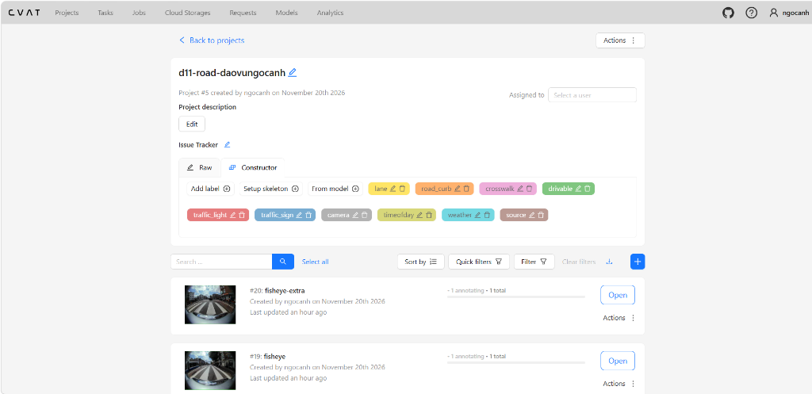
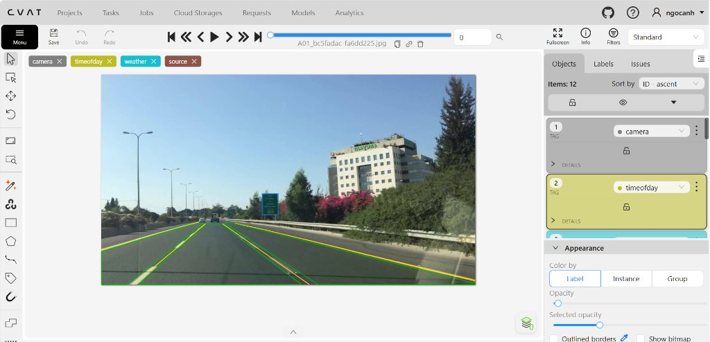
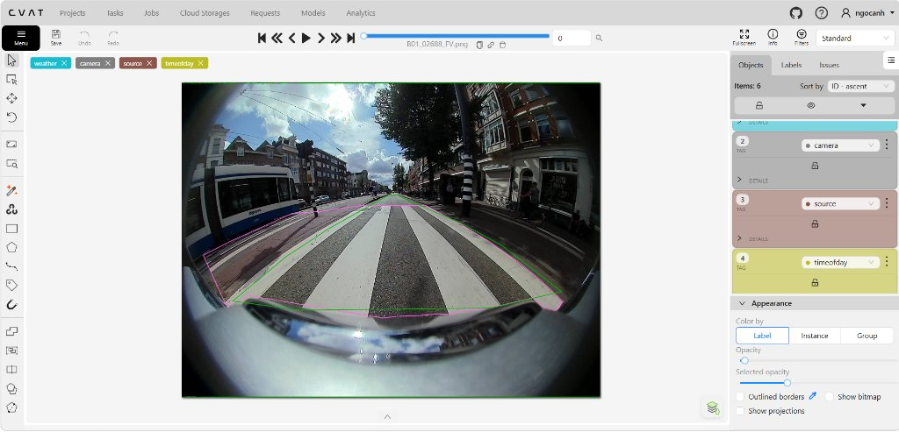

# Báo cáo cá nhân — Ngày 11
Họ tên: Đào Vũ Ngọc Ánh              Mã học viên: 2A202603071  
Phiên bản CVAT (Help → About): 2.81.0  
Guideline: Road v1.0               Lần nộp (`revision` trong manifest): 2  
Thời điểm export (ngày giờ trên CVAT): 2026-11-21 12:00:30 (UTC+7)    Số lần nộp lại sau Rework: 1  

## 1. Kiểm project
| Mục | Đúng như guideline Road v1.0? | Ghi chú |
| --- | --- | --- |
| 6 label, đúng kiểu | Đúng | crosswalk (polygon), drivable (polygon), lane (polyline), road_curb (polyline), traffic_light (rectangle), traffic_sign (rectangle) |
| Thuộc tính và giá trị | Đúng | Đủ thuộc tính theo đặc tả: lane (position, style, color, kind), drivable (area), traffic_light (color, target, facing, occlusion), traffic_sign (type, facing, occlusion) |
| 4 tag ảnh | Đúng | 4 tag: camera_type (front/fisheye_*), timeofday (day/night/dusk), weather (clear/rainy/overcast/foggy), source (real/synthetic) |
Cách kết thúc polyline trên bản CVAT này: Nhấn phím `N` trên bàn phím hoặc double-click vào điểm cuối cùng của đường polyline.  
Cách đặt tag ảnh trên bản CVAT này: Chọn tab Objects bên phải, chọn mục Tags -> Add tag -> chọn nhãn tag và giá trị thuộc tính tương ứng cho từng frame.  

## 2. Số lượng đã gán
| Task | Ảnh | lane | road_curb | crosswalk | drivable | traffic_light | traffic_sign |
| --- | ---: | ---: | ---: | ---: | ---: | ---: | ---: |
| front | 12 | 32 | 4 | 4 | 25 | 36 | 46 |
| front-extra (đã làm 4 / 4) | 4 | 10 | 2 | 2 | 10 | 8 | 15 |
| fisheye | 8 | 5 | 5 | 8 | 8 | 4 | 10 |
| fisheye-extra (đã làm 4 / 4) | 4 | 0 | 4 | 4 | 3 | 0 | 1 |

## 3. Bảng ca khó
| Ảnh | Nhãn | Phân vân giữa | Đã chọn | Lý do |
| --- | --- | --- | --- | --- |
| A04 | lane | Vẽ 2 polyline riêng cho vạch kép hay 1 polyline | 1 polyline duy nhất ở tâm dải vạch đôi | Quy tắc 2.2 của Road v1.0: vạch kép vẽ 1 polyline duy nhất chạy giữa hai vạch, gán `kind = double`, `style = solid`, `color = yellow`. |
| A05 | lane | Vẽ đoán vạch L1/R1 hay bỏ qua vì mặt đường ngã tư mòn hết sơn | Bỏ qua vạch L1/R1 | Quy tắc Road v1.0 và chỉ dẫn của Lead: Nếu mặt đường ngã tư không còn vết sơn nhìn thấy được, tuyệt đối không suy đoán tự vẽ vạch. |
| A09 | lane | Cắt thành nhiều polyline cho từng khúc vạch đứt hay vẽ 1 đường liền | 1 polyline chạy dọc tâm | Quy tắc 2.3: Vạch đứt vẽ bằng 1 polyline liên tục xuyên qua các khoảng trống, đặt thuộc tính `style = dashed`. |
| B02 | traffic_sign | Đặt `edge_zone = false` hay `true` cho biển báo ở góc phải | `edge_zone = true` | Tâm bounding box cách tâm quang học ảnh fisheye > 512 px (vượt quá 80% bán kính trường nhìn $R=640 \times 0.8 = 512$), chịu biến dạng méo hình học mạnh. |

## 4. Phiếu QC 1 nhận được
Bạn kiểm lô của tôi: doanquangminh  Quyết định nhận được: Rework (Lần nộp mới: Revision 2)  
| Mã lỗi | Số lỗi | Đồng ý? | Đã sửa? |
| --- | ---: | --- | --- |
| QC1-08 đèn, màu | 1 | Đồng ý | Đã sửa đèn hướng về xe ở A14 từ red thành green |
| QC1-03 position | 1 | Đồng ý | Đã sửa mép vỉa hè phải B04 từ lane R1 thành road_curb |
| QC1-06 style, color, kind | 1 | Đồng ý | Đã đổi màu vạch L1 ở A14 thành yellow |
| QC1-05 vạch đứt, che | 2 | Đồng ý | Đã xóa nét vạch L2 vẽ thừa ở vạch đôi A04, A14 (và A11) |
| QC1-07 vùng lái | 2 | Đồng ý | Đã kéo vùng drivable ở A08 vượt qua crosswalk xuống mép capo |

## 5. Kiểm file export
| File | Mở lại được? | Số shape ảnh 1 (job / file) | Số shape ảnh 2 (job / file) | Tag camera có trong XML? |
| --- | --- | --- | --- | --- |
| daovungocanh-front.zip | Có | 8 / 8 | 7 / 7 | Có (`front`) |
| daovungocanh-fisheye.zip | Có | 2 / 2 | 6 / 6 | Có (`fisheye_front`) |

## 6. Ảnh chụp màn hình
1. **Tab Labels của project:**  
   

2. **Một ảnh camera trước đã gán đủ (làn, vùng lái, đèn/biển):**  
   

3. **Một ảnh fisheye đã gán, phóng to đoạn polyline cong:**  
   

4. **Một đoạn XML có `<polyline label="lane">`:**
```xml
<polyline label="lane" source="manual" occluded="0" points="450.0,850.0;480.0,750.0;510.0,650.0;530.0,560.0;545.0,480.0" z_order="0">
  <attribute name="position">L1</attribute>
  <attribute name="style">dashed</attribute>
  <attribute name="color">white</attribute>
  <attribute name="kind">single</attribute>
</polyline>
```

## 7. Tự đánh giá
- **Lỗi dễ mắc nhất hôm nay (theo mã QC1-xx), và cách tránh ở Ngày 20:**
  Lỗi dễ mắc là QC1-05 (phân vân cắt khúc vạch đứt hoặc vẽ sai tâm vạch) và QC1-07 (vẽ vùng lái tràn lên nắp capo hoặc xe phía trước). Cách tránh: Luôn nhớ quy tắc vạch đứt vẽ 1 polyline liên tục từ đáy nắp capo lên đến điểm biến mất; vùng drivable phải trừ vật cản (xe trước, vỉa hè) và cắt gọn mép dưới không được phủ lên capo xe mình.

- **Nhãn của bạn đi vào model ở đâu? Chọn một lỗi đã sửa và nói nó làm model học sai thế nào:**
  Nhãn `lane` và `drivable` trực tiếp đi vào mô hình phát hiện làn đường theo phương pháp row-anchor (như UFLD) và mạng phân vùng ngữ nghĩa (Semantic Segmentation). Nếu polyline vạch làn bị dừng sớm (chẳng hạn kết thúc trước nắp capo 40–50px) hoặc bị ngắt khúc, mô hình row-anchor tại các hàng pixel sát đầu xe (như y = 720, 680) sẽ bị gán nhãn "không có làn" (background/no-lane). Khi xe tự hành chạy thực tế, thuật toán bám làn (Lane Keeping Assist - LKA) phụ thuộc rất lớn vào vị trí vạch kẻ ở vùng gần xe nhất để tính độ lệch ngang (lateral offset). Việc mất dự đoán hoặc dự đoán giật cục ở vùng này sẽ khiến hệ thống điều khiển lái phát lệnh bẻ lái đột ngột, gây mất an toàn nghiêm trọng.

## 8. (Tùy chọn, buffer) Từ polyline đến đích row-anchor
| y | 720 | 680 | 640 | 600 | 560 |
| --- | ---: | ---: | ---: | ---: | ---: |
| x của chúng tôi | 490 | 500 | 512 | 522 | 530 |
| x của bạn kia | 488 | 502 | 510 | 521 | 532 |

Trả lời 3 câu:
1. **Năm số x đó chính là đích mà một model row-anchor học cho vạch này. Nếu bạn dừng polyline sớm 40 px, hàng nào đổi thành "không có làn"?**
   - Hàng `y = 720` (hàng sát đáy ảnh gần đầu xe nhất) sẽ đổi thành "không có làn" (no-lane / background), khiến mô hình bị mất tín hiệu định vị cục bộ ngay trước đầu xe.
2. **So với bạn được kiểm (cùng ảnh): ở hàng 720 và hàng 560, hai bạn lệch nhau bao nhiêu pixel? Lệch ở hàng nào ảnh hưởng LKA nhiều hơn (slide 25)?**
   - Ở hàng 720 lệch $|490 - 488| = 2$ px; ở hàng 560 lệch $|530 - 532| = 2$ px.
   - Lệch ở hàng 720 ảnh hưởng đến LKA nhiều hơn vì hàng 720 tương ứng với khoảng cách thực tế ngay sát đầu xe (khoảng 3–5m). Sai số pixel ở vùng gần chuyển đổi thành sai số góc lái tức thời lớn hơn rất nhiều so với vùng xa (vốn chỉ phục vụ việc lập quỹ đạo dài hạn look-ahead).
3. **Nếu polyline vẽ từ xa về gần (ngược quy tắc 2), cách tính trên có đổi không? Script nào sẽ gặp khó?**
   - Về mặt toán học đường cong không đổi nếu được sắp xếp lại theo trục y, nhưng các script trích xuất dữ liệu mảng thô (raw polyline points) không qua bước tiền xử lý sắp xếp `sort(by='y')` sẽ bị đảo ngược thứ tự điểm, dẫn đến phép nội suy `np.interp` bị sai lệch hoàn toàn hoặc vỡ ma trận mục tiêu (ground truth row anchors).
